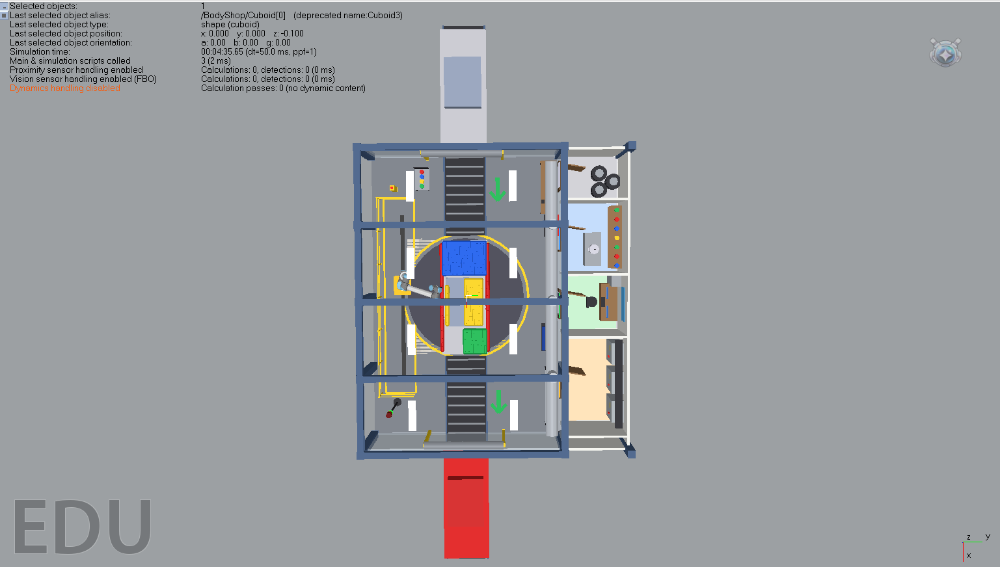
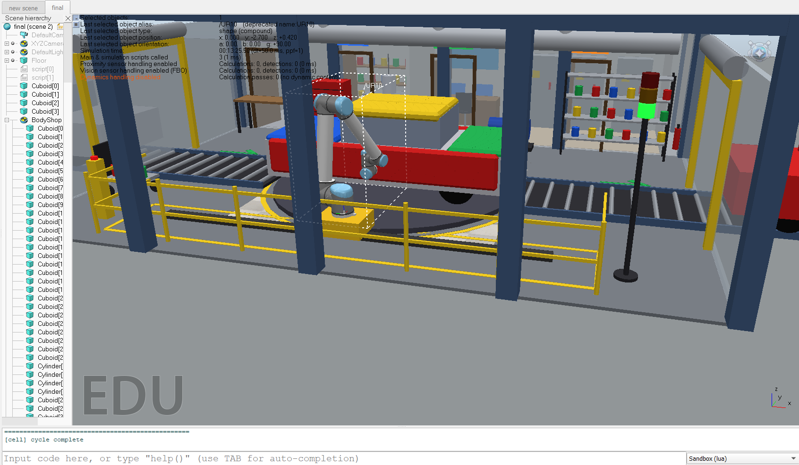
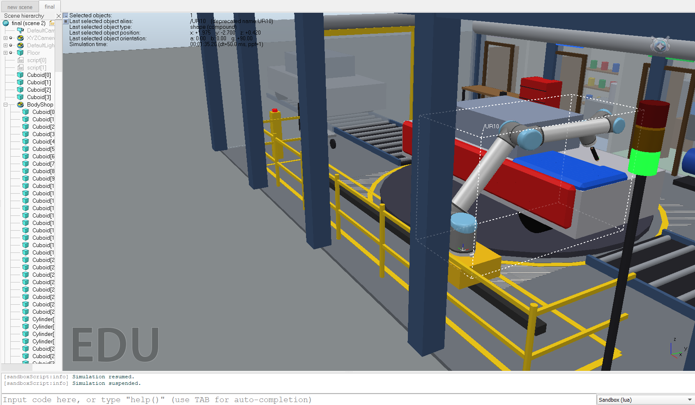
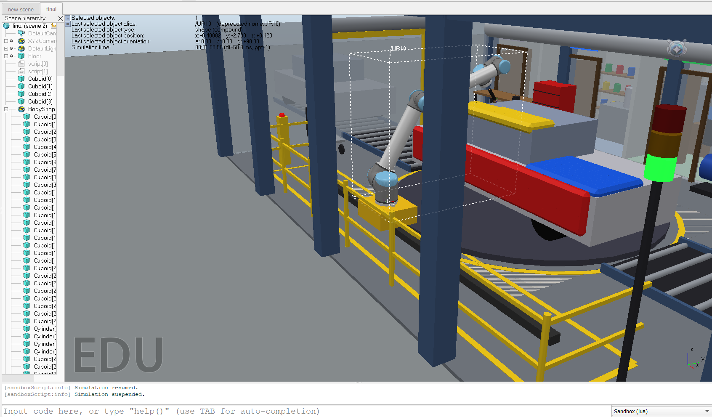
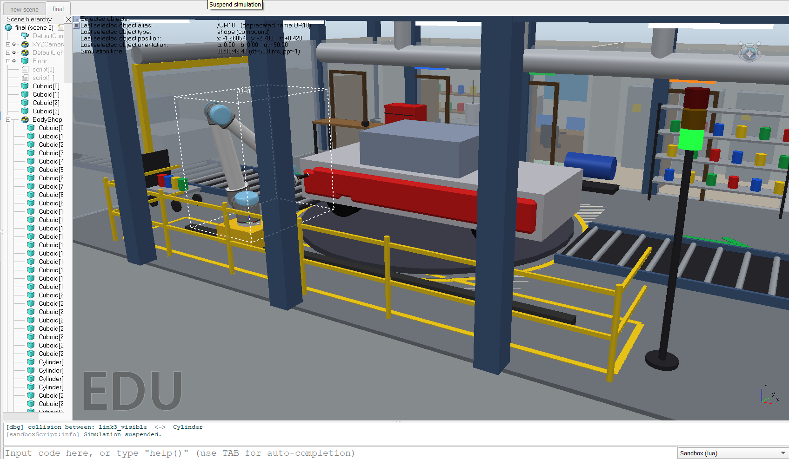

<div align="center">

# 🎨 AutoCoat Cell
### 6-DOF UR10 Robotic Car Painting Cell — Trajectory Planning, Kinematics & Collision Simulation




</div>

---

## 📌 Overview

An automated spray-painting cell in which a **6-DOF UR10 manipulator** applies a uniform coating across a full-scale sedan (4800 × 1900 × 1600 mm) inside a 12 m × 8 m cleanroom booth.

The project covers the full pipeline:

**Toolpath planning → D-H kinematics → collision checking → 3D simulation with spray deposition**

- **Candidate:** K S V S Sobhita
- **Simulator:** CoppeliaSim (V-REP)
- **Robot:** UR10 6-DOF articulated manipulator

---

## 🎬 Simulation Preview

| Rest position | Painting hood |
|:---:|:---:|
|  |  |

| Painting roof | Painting side panels |
|:---:|:---:|
|  |  |

---

## ⚙️ Specifications

| Parameter | Value |
|---|---|
| Car | 4,800 × 1,900 × 1,600 mm sedan |
| Booth | 12,000 × 8,000 mm cleanroom, downdraft ventilation |
| Manipulator | UR10, 6-DOF serial |
| End-effector | Rotary bell atomizer, 250 mm standoff |
| Surfaces | Hood, roof, left side panels & doors, trunk deck |
| Safety | Perimeter barriers, light curtains, e-stop envelope |

---

## 🔬 Technical Highlights

1. **Raster toolpath planning** — serpentine paths with constant 250 mm standoff and surface-normal tool orientation.
2. **D-H forward kinematics** — joint space → TCP world coordinates, with joint-limit checks.
3. **Two-tier AABB collision checking** — robot links vs. car body, cabin and conveyor fixtures.
4. **Spray visualization** — atomizer cone with dynamic color deposition on panels.

---

## 🚀 Run It

**CoppeliaSim scene**
1. Open CoppeliaSim → load `Simulation_Files/final.ttt`
2. Press ▶ — the UR10 paints hood, roof, side panels, trunk.

**Python modules** (standalone, no extra setup)
```bash
python Simulation_Files/trajectory_generator.py       # waypoints, normals, standoff offsets
python Simulation_Files/kinematics_and_collision.py   # FK, joint limits, AABB tests
```

---

## 📁 Structure

```
├── Simulation_Files/
│   ├── final.ttt                      # CoppeliaSim scene
│   ├── trajectory_generator.py        # Multi-surface raster planner
│   └── kinematics_and_collision.py    # D-H kinematics + AABB collision
├── Report/
│   ├── Technical_Report.docx
│   └── Technical_Report.pdf
├── Screenshots/                       # Viewport captures
└── README.md
```

---

## 📄 Report

Full write-up: [`Report/Technical_Report.pdf`](Report/Technical_Report.pdf)
